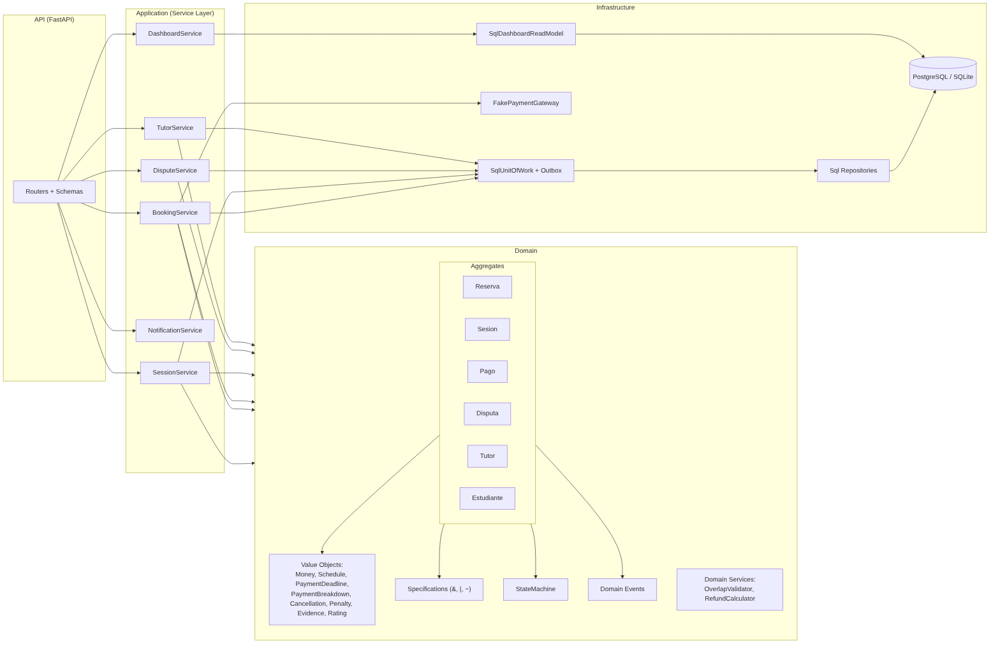

# Arquitectura de AulaPlus

Monolito modular con dependencias hacia el dominio (Arquitectura Hexagonal + DDD).

| Capa | Carpeta | Responsabilidad |
|---|---|---|
| API | `src/api` | HTTP, validación Pydantic, mapeo de errores, roles |
| Aplicación | `src/application` | Casos de uso (Service Layer), puertos (UoW, pasarela, read model) |
| Dominio | `src/domain` | Aggregates, Value Objects, Specification, State Machine, servicios y eventos |
| Infraestructura | `src/infrastructure` | SQLAlchemy, Unit of Work + outbox, pasarela simulada, configuración |

## Diagramas
- BPMN adaptado (reglas del BRD sobre el flujo original): [bpmn_adaptado.png](diagrams/bpmn_adaptado.png)
- Clases UML: [class_diagram.png](diagrams/class_diagram.png)
- Estados: [Sesión](diagrams/state_sesion.png), [Pago y Disputa](diagrams/state_pago_disputa.png)
- Secuencia: [Reserva y pago](diagrams/seq_reserva_pago.png), [Disputa](diagrams/seq_disputa.png)
Los `.mmd` fuente están en `diagrams/`.

## Patrones y dónde viven
| Patrón | Implementación |
|---|---|
| Aggregate / Value Object | `src/domain/{reserva,sesion,pago,disputa,tutor}.py`, `value_objects.py` |
| Specification | `src/domain/specifications.py` |
| State Machine | `src/domain/state_machine.py` + tabla en cada aggregate |
| Domain Service / Strategy | `OverlapValidator`, `RefundCalculator` + `RefundPolicy` |
| Repository / Unit of Work / Outbox | `src/domain/repositories.py`, `src/infrastructure/{repositories,unit_of_work}.py` |
| Service Layer | `src/application/services.py` |
| CQRS-light | `SqlDashboardReadModel` |
| Adapter | `FakePaymentGateway` (puerto `PaymentGateway`) |

## SOLID
- **S**: cada aggregate cambia por una razón (p. ej. `Pago` solo reglas monetarias; `Disputa` solo ciclo de resolución).
- **O**: nuevas reglas = nuevas `Specification` o `RefundPolicy`, sin tocar las existentes.
- **L**: toda implementación de repositorio o de `Specification` es sustituible por su puerto (se prueba con SQLite y PostgreSQL).
- **I**: puertos pequeños por aggregate (`ReservaRepository`, `PagoRepository`…) en lugar de un repositorio genérico.
- **D**: la aplicación depende de puertos; `container.py` es la única raíz de composición.

## Trazabilidad
Análisis → arquitectura → código → pruebas en [../traceability.md](../traceability.md) (validada automáticamente por `tests/test_traceability.py`).
